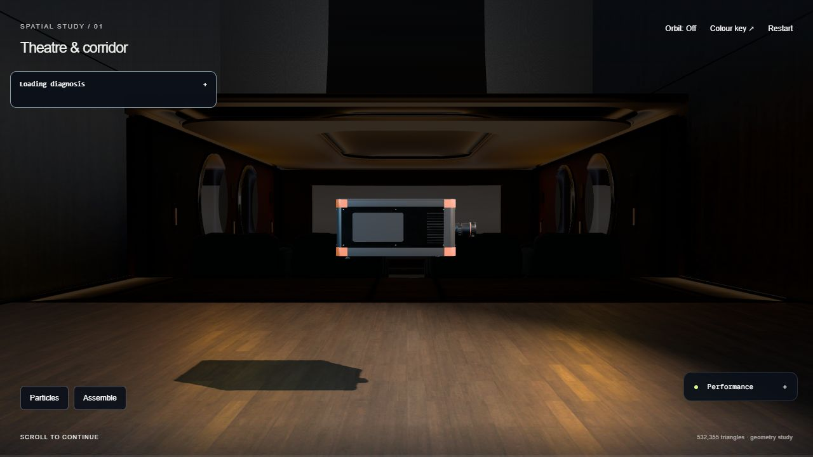
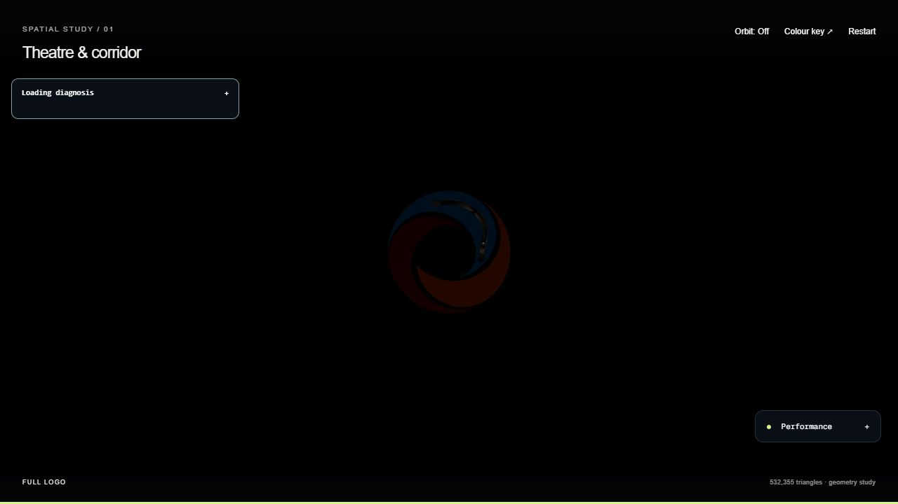

# Formation light, liquid entrance and exit motion — 26 October 2026

## Changes

1. **Room dimming:** the accepted baked textures remain opaque. Their bright direct-light pixels and reflected fill now have different linear-light attenuation, with the ceiling/fixtures losing their bright source first. This preserves dark surface detail instead of multiplying the entire image equally. The visit still stays dark until Restart. This is an approximation using fixed combined bakes, not a fully dynamic replacement of their baked lighting.
2. **Projector key and floor:** the existing warm spotlight is stronger, aims lower and covers the platform. The existing floor geometry now receives live lighting and the projector's shared source-mask shadows. Its walnut bake supplies the preserved base and an approximate diffuse wood colour; no new texture was made. The redundant transparent shadow-catching plane was removed. The original shadow map remains 1024 on computers / 512 on phones, with the existing throttled pose updates. High-detail replacement updates both uses of the same floor map.
3. **Liquid:** 10% smaller at the sphere stop, a centred vertical entrance without lateral travel or roll, 1.3 s arrival instead of 1.8 s. Slow turning/flow are 25–27% quicker. The next morph interpolates from the smaller scale without a jump. Matte finish, page coverage and input steps remain.
4. **Exit:** demand rendering could remain idle at the slide top or turned stop. Its next frame counted the entire resting time toward a 1.4 s turn or 4.5 s pullback, sometimes skipping the shot. The exit clock now excludes time before the input that wakes each movement. Scroll-driven slide restarts use the same correction. Two regressions failed before this correction and pass afterwards. Existing exact camera joins and separate input stages remain.
5. **Logo backdrop:** the corridor background smoothly reaches pure black during the turn and remains black for the final logo.

The first full-run trace also found two 53 ms moving pauses. Both coincided with a new shader program: the live floor's first normal draw and its first reflected draw. Initial projector preparation now compiles both output variants of the whole mounted scene and submits them privately at the preceding stationary stop. Preparation remains serial and avoids the opening camera move. It deliberately warms more existing resources; it is not a download-size reduction.

Production build/TypeScript, targeted ESLint and all 46 regression tests pass. No source Blender, GLB, pose buffer or baked texture was edited. Original code backups and logs are in `D:/CodexOutputs/Five_Fixes_20261026/`.

## Evidence

- `before-returned.jpg`: previous lighting, same fixed returned camera; copied from the previous accepted opening/ambient report.
- `returned.jpg`: current lighting and actual floor shadow.
- `formation.jpg`: formed/exploded stop with individual part shadows; not an exactly time-matched particle frame.
- `liquid.jpg`: smaller sphere at its stop.

Local preview: `http://192.168.1.5:3000/`.

## Final computer-profile run

The complete 1280 × 720 laptop-effect journey reached the final black logo after the native sections, slide, deliberate stop, turn and pullback. No errors and no recorded browser pauses over 50 ms during camera/formation/liquid movement. Initial render and stationary preparation still recorded 107 ms and 93 ms pauses. The previous moving shader stalls are absent from the rerun. Raw evidence: `laptop-report.json`; the earlier report identifying both first-draw compilations is retained outside the project with the code backups.

The smaller sphere settled in approximately 1.3 s and the automatic third-section return began 26 ms after reaching its bottom. All 127 protected public assets remain byte-identical (`assets.json`). These are cached workstation browser measurements, not physical laptop/phone or cold-network speed claims.

## Portrait phone-effect run

The full 390 × 844 run also completed reveal, assembly, return, corridor, liquid morph, native sections, slide, turn and black logo. It retained the approved no-flying-particles mobile effect. No errors or recorded moving pauses above 50 ms; initial render/stationary preparation still recorded 93 ms and 107 ms pauses. Sphere arrival: 1,307 ms. Native-page return delay: 26 ms. Evidence: `mobile-report.json`, `portrait-returned.jpg`, `portrait-liquid.jpg`, `portrait-logo.jpg` and `verification.json`. The local quality override runs on this workstation GPU and does not reproduce a physical phone's hardware, user agent or texture policy.

Final UI/source review: frame work remains imperative, effect/async cleanup retains cancellation and resource ownership, and shared floor map replacement restores both bindings. No qualifying Next.js framework issue was found; the fixes concern application shading, demand clocks and GPU preparation. No commit or deployment was made.

