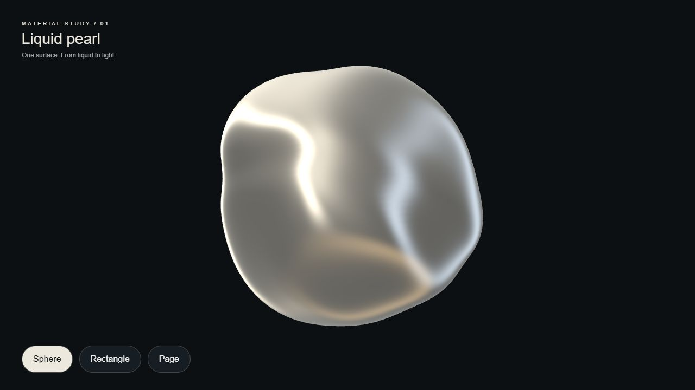
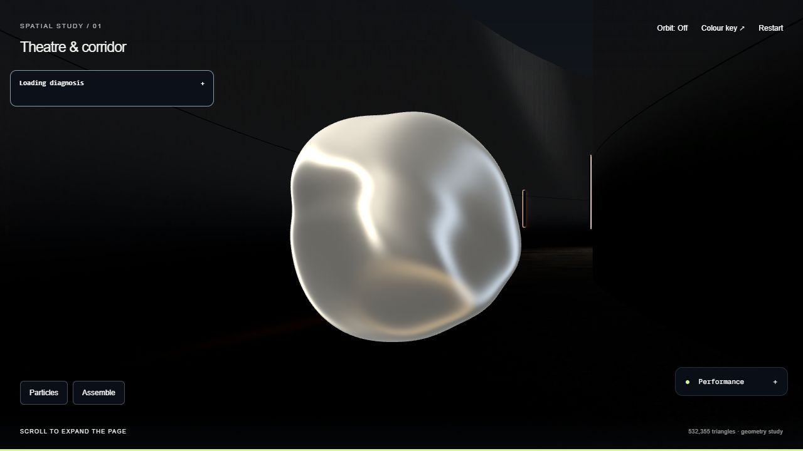
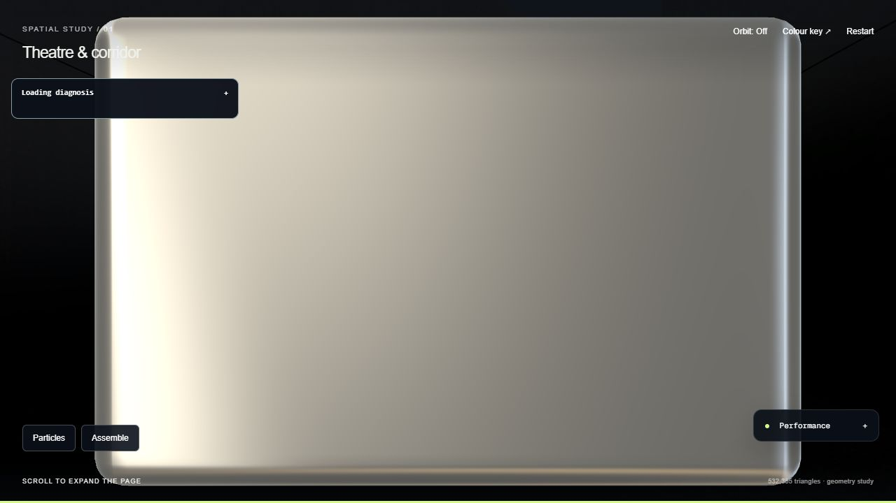

# Liquid sphere → page — 26 October 2026

The corridor's page entrance is now one closed liquid pearl. It arrives with a flowing fold, settles, then unfurls diagonally into a rounded rectangle on the next scroll. The following scroll flattens and expands it into the white HTML page. Existing input steps, camera stops and the page-to-corridor return remain intact.

## Rendering

Original procedural vertex/fragment shaders animate the same surface throughout. Smooth deformed normals carry broad warm and cool studio highlights across the fold. These highlights are a designed liquid appearance, not live corridor reflections. The material converges to the exact page background before HTML takes over, including the sand background on return.

- One mesh, one material, one additional visible draw call. No external textures, GLBs, HDRIs, fluid cache, postprocessing or extra scene-capture pass.
- Computers: 27,648 triangles. Mobile: 12,288 triangles. Detail follows the existing device-quality selection; local diagnostic overrides exercise the same mobile program on this workstation.
- GPU deformation only; frame updates change transforms/uniforms without allocating geometry or triggering React state updates.
- Normal and offscreen programs prepare privately at an earlier stationary stop. Preparation never runs during initial automatic camera travel. Covered page-return preparation waits for both projector and liquid readiness.
- Arrival lasts 1.8 seconds; morph and final expansion each last 1.1 seconds. Motion settles to demand rendering between gestures. Reduced-motion preference completes each step immediately.
- All 127 protected public assets remain byte-identical. No scene textures, original GLBs, projector animation or lighting were changed.

## Verification

Production build/TypeScript and targeted lint pass. All 43 regression checks pass. New checks cover the final page across portrait phone, tablet and ultrawide aspect ratios, and exact stationary motion endpoints.

Laptop-effect browser run at 1280 × 720: sphere entrance, morph, viewport coverage, native page scrolling and covered scene return all completed without console errors. No browser pause over 50 ms was recorded during the three liquid animation intervals. Initial render/background preparation and covered remount still have their own pauses. This workstation test does not establish performance on physical phones or laptops.

The final mobile-effect run at 390 × 844 also completed all three stages, native page scrolling and the covered return without errors or animation pauses over 50 ms. Its preflight report confirms 12,288 triangles and the mobile program. The three stages measured 1.801 s, 1.107 s and 1.107 s. This is a portrait browser test on the same workstation, not a measurement on a physical phone. Raw reports and `verification.json` are saved beside this document.

Evidence and source backups: `D:/CodexOutputs/Liquid_Page_20261026/`. The isolated material-study route used for the first screenshot was removed after capture; its sources remain in that backup folder.

Reference reading: [pmndrs shader-material example](https://pmndrs.github.io/examples/examples/shadermaterials), [wobbling-sphere example](https://pmndrs.github.io/examples/examples/wobbling-sphere), [R3F demand rendering](https://r3f.docs.pmnd.rs/advanced/scaling-performance). The liquid shader and geometry morph are original to this project; example assets and dependencies were not copied.

