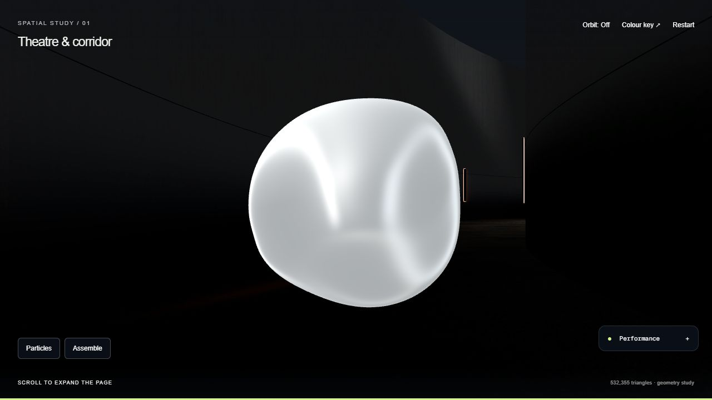
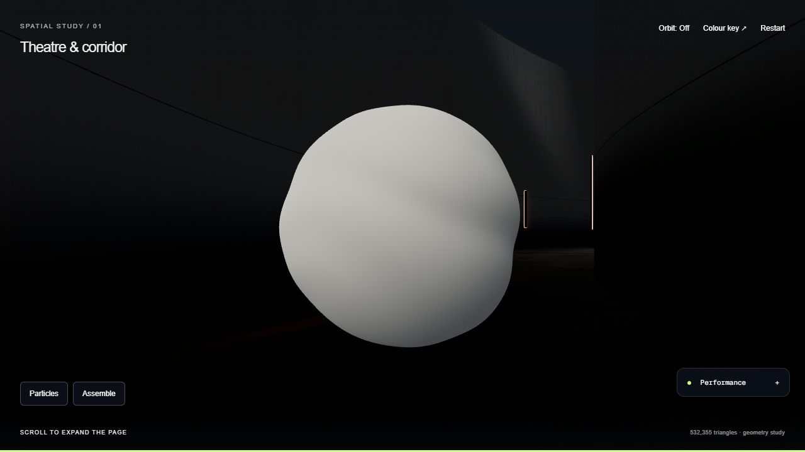

# Softer corridor liquid — 26 October 2026

The user requested less gloss and a finish that belongs in the corridor. This supersedes the pearl's studio-ribbon shading in `docs/three-fixes/README.md`; its page-return and particle corrections remain active.

The shader now uses broad diffuse ivory shading, charcoal shadows, a restrained warm side light and a small cool ceiling fill. The illumination direction is set in corridor world space, so the turning surface moves through a stable light rather than carrying camera-facing chrome streaks. This is an authored lighting approximation, not captured reflections or a fluid simulation. There is no clearcoat or narrow specular lobe.

One curved surface current echoes the theatre's crescents. Smaller travelling wakes and a subtle twist move through that current. Continuous slow rotation, reduced motion support, stage timings, the rectangle/page morph and exact HTML background match are preserved. The effect still uses one existing mesh/draw, the same desktop/mobile subdivision counts and no texture, model, capture target or network asset.

Only `liquid-page-material.ts` and `corridor-page.tsx` were changed in runtime code. Before-code backups are in `D:/CodexOutputs/Liquid_Refinement_20261026/`. All 127 protected assets remain byte-identical. Production build/TypeScript, targeted ESLint and all 44 regression checks pass. Browser evidence is saved beside this report.

The final production preview was inspected at 1280 × 720, then resized to 390 × 844. Continuous turning, sphere-to-rectangle morph, full white HTML handoff and automatic third-section return all completed. The native scroll immediately entered `pageReturning`, then reached the slide. No browser console errors were reported. Portrait resizing is a layout check on this workstation, not a physical-phone speed measurement or a separate mobile GPU profile run. Final preview: `http://192.168.1.5:3000/`.

## Appearance comparison

These captures use the same corridor camera. Rotation and flowing shape are continuous, so they are not frame-locked comparisons.

Before:

After:

