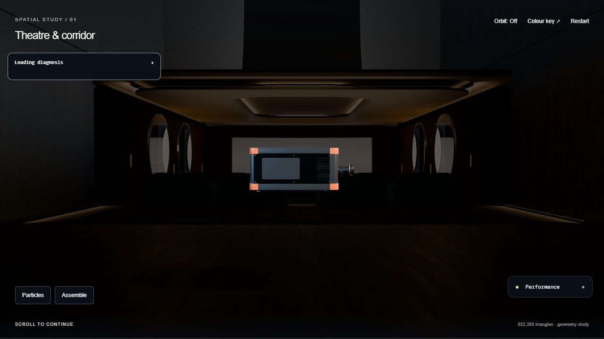
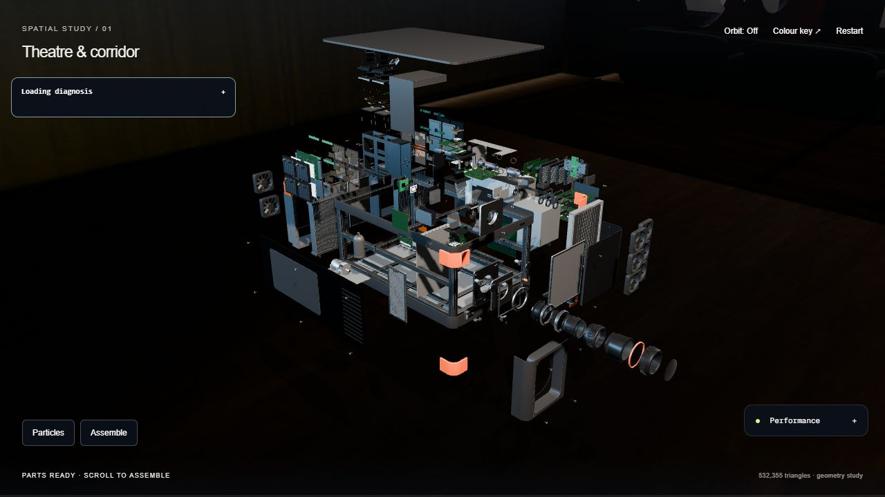

# Opening movement and low-light correction — 26 October 2026

The first automatic backward movement now waits for the opening scene's GPU preflight. Projector and corridor preparation begin after this movement settles, so their decode, mount and shader work cannot overlap its start. The animation clock ignores time spent waiting for readiness, including a blocking first submission. The authored two-second hold, 2.5-second travel, endpoint and queued input remain unchanged.

Theatre illumination now bottoms out at 10% of its baked linear-light output. Both baked floors bottom out at 25%, keeping their surface and wood grain visible in darkness. Existing ambient illumination retains a small minimum for physical materials. The same smooth fade still stays dim through assembly, return and replay until Restart. The projector's local cinematic key remains. No additional texture, light, shadow pass, geometry or GLB was added.

## Verification

- Production build and TypeScript pass; targeted runtime lint passes.
- 41 regression checks pass, including a simulated one-second GPU preparation stall, intro queue priority, exact opening endpoints, queued input and monotonic lighting.
- Latest production browser capture at 1280 × 720, laptop effect profile on this workstation: opening GPU ready 1.243 s; movement starts 3.103 s and settles 5.610 s; projector and corridor requests start 5.623 s. No captured browser pauses above 50 ms during this moving interval; no console errors through formation, assembly and camera return.
- Initial render and later stationary preparation still produced pauses up to 107 ms. This is not a claim that physical phones or laptops are hitch-free. The local reload was cached and does not establish network loading speed.
- Compared formation and returned views: ceiling shape, wall outlines and walnut floors remain visible with low light. Full-lit opening is unchanged. No public assets were edited.

Raw reports and original code backups: `D:/CodexOutputs/Opening_Ambient_20261026/`. The earlier `docs/sequence-corrections/` evidence remains historical.

