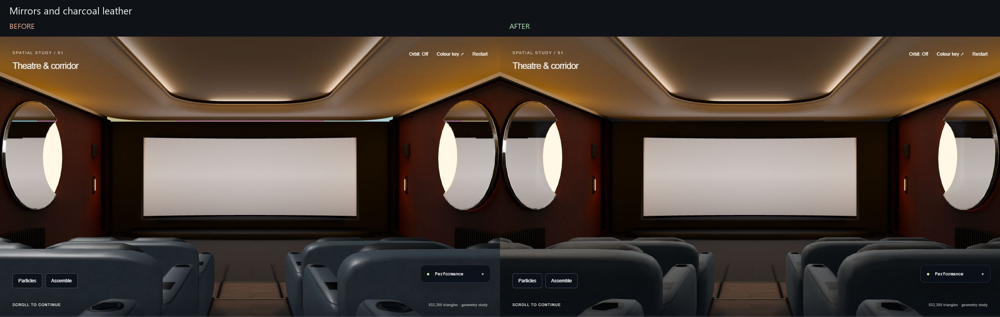
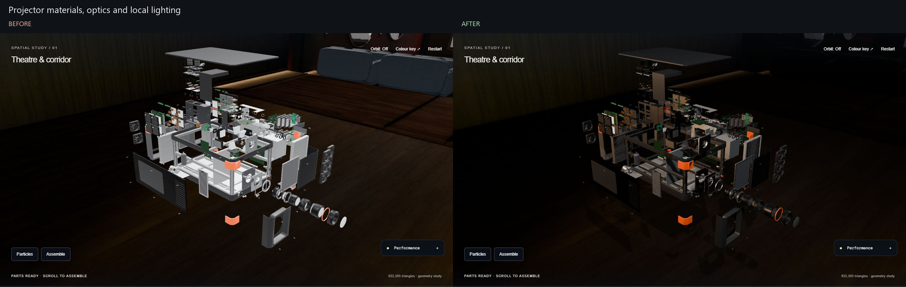
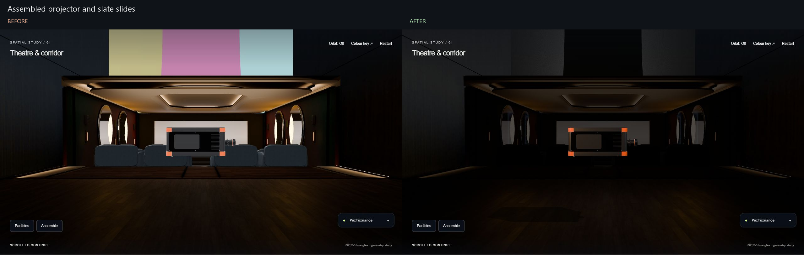
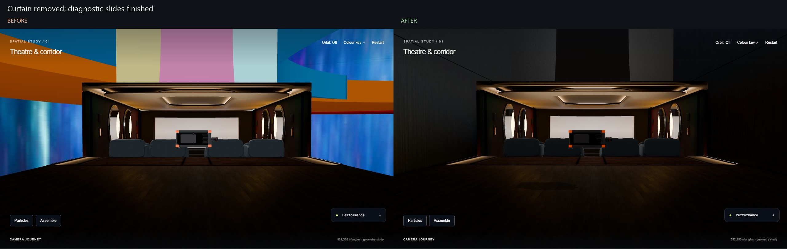
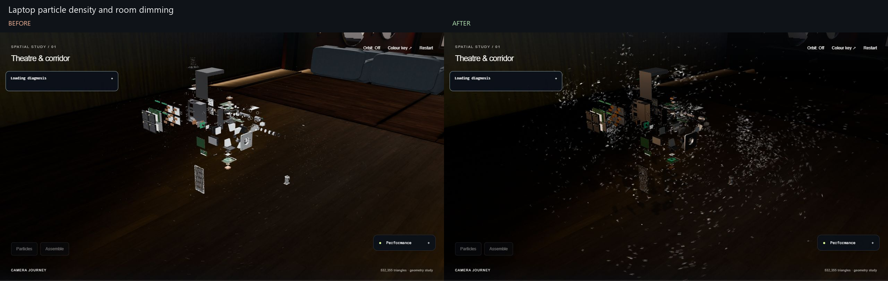
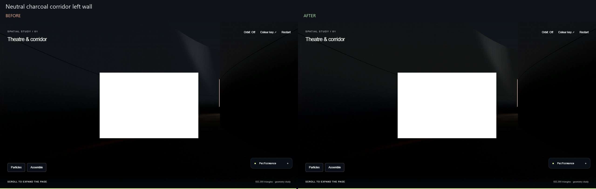

# Scene polish and material corrections

25 October 2026. Active project: `D:/New folio/new site code/new_site_three`.
LAN preview: http://192.168.1.5:3000/. No commit or deployment.

## Changes

- **Moon glass:** live planar room reflections are retained. Capture resolution is increased to 60% of the drawing buffer on computers (capped at 1024) and 45% on phones (capped at 512). Linear filtering replaces blurry mip filtering; a restrained angle-dependent coating darkens the reflection slightly at normal incidence. The white crescent and warm optic illumination retain their original simple materials. The room really is reflected, including its large pale cinema screen; these are not replacement photos or camera bakes.
- **Sofas:** retain the accepted charcoal source upholstery, shared 1K base and packed AO/roughness/metalness textures, compressed 1,479-triangle mesh, twelve instances and one draw. Leather roughness now varies subtly around 0.61-0.67, with a small warm environment reflection. The exaggerated procedural bump tested during development was rejected and removed. No new sofa files were downloaded.
- **Projector:** preserve all 59 source material identities and their base colours, roughness ranges, metallic values, emission, IOR and specular values, plus the existing brushed base/packed/normal maps. Optical material PH_glass (29,660 triangles) is split into a separate runtime index buffer, sharing the original vertex attributes. It uses physical transmission, IOR 1.52, low roughness, thin glass thickness and a restrained coating. The remaining 400,757 triangles use opaque physical materials. All original part transforms, source normals and assembly poses remain intact. This intentionally improves the source's PH_glass, whose transmission was actually zero; it is not exact Cycles parity. Some internal source microfinish image channels were never exported by the prior pipeline; those tiny internal parts still use the preserved material constants, not newly claimed full image-map parity.
- **Laptop/phone particles:** retain the compressed sampled source-flight caches. Four GPU siblings per laptop trajectory and six per phone trajectory give 26,624 and 13,056 rendered streaks respectively, with bounded +/-9 mm offsets. Brightness/coverage no longer makes most small particles disappear. Slow-frame adaptation reduces count in measured steps but cannot collapse below two siblings per original trajectory. It only starts after sustained frame times worse than 22 FPS. Strong desktop GPUs keep the full original procedural field. Counts describe the submitted field, not how many particles are visible at every animation frame. Sibling paths are approximations, not additional independently baked Blender particles.
- **Formation lighting:** one timeline drives theatre dimming, indirect projector illumination, a single flash, persistent local key/rim lights and recovery. The room drops to 7% while local lighting continues through formation and assembly. It recovers smoothly after assembly. The projector floor keeps a local light pool and a live contact shadow. A single 512px phone / 1024px computer shadow map updates when the projector pose changes. The exploded hold stops rendering at rest; it no longer invalidates continuously just because the room is dimmed. Optical transmission uses half-resolution background rendering on phones and 75% on computers; distant mirror captures exclude the tiny transmissive optics to avoid multiplying transmission passes.
- **Curtain:** the surrounding dome, texture, one-shot cue and shell-fade branches are removed. The 0.3-second wide hold and existing camera travel remain. Recovery copies of the removed files are outside public in `D:/CodexOutputs/Scene_Polish_20261025/removed-curtain/`.
- **Slides A/B:** replace diagnostic materials with warm honed slate and charcoal edges. Selection uses the original material identity, because GLTFLoader sanitises object-name spaces. Very restrained world-space colour/roughness variation avoids needing image UVs or stretched bitmap detail. Existing geometry and motion remain unchanged.
- **Corridor LEFT wall:** derive a neutral charcoal replacement from the approved original 6K atlas, reducing only the cool cast and subpixel noise while keeping warm slot-light reflections and source detail. Keep the identical bake-matched UV sidecar. Computers use a new 6K KTX2; phones a real 2K derivative. This is a deliberate colour/noise correction to the existing bake, not a fresh Blender bake and not an all-angle reflection solution. The right wall, ten light assemblies and floor texture are untouched.

## Texture audit

`texture-audit.json` records 26 runtime surface/mesh mappings, using actual decoded Draco attributes and active UV sidecars. No non-finite UVs, out-of-atlas values or collapsed UV surface areas were found. The brushed projector image map also has no invalid or collapsed areas. Source constant-colour projector materials intentionally have unused zero UVs.

Curved corridor charts have up to 1.41:1 local anisotropy. This alone does not show stretched grain: the source procedural detail was baked through those identical charts. We preserved the verified charts instead of stretching an existing image onto new UVs. Native sofa UV correspondence was verified in the preceding task. The slides use world coordinates, not image UV projection. Baked sheen/reflections on the architectural surfaces remain fixed-view approximations.

Run: `node scripts/audit-active-textures.mjs`. It uses the saved local glTF inspection dependency at `D:/CodexOutputs/Scene_Fixes_20261025/inspect-assets.mjs`.

## Asset and loading impact

No existing asset was re-encoded or overwritten. SHA-256 checks confirm 121 pre-existing public files, including **21 remaining GLBs**, are byte-identical. Only the explicitly removed curtain GLB/texture are absent. Two new corridor wall files are selected by the current manifest. The existing sofa/projector models, source maps and particle caches remain compressed and unchanged.

| Requested asset group | Phone | Computer |
| --- | ---: | ---: |
| Opening models/textures | 15,654,264 B | 23,980,098 B |
| Later corridor models/textures | 4,225,651 B | 16,155,997 B |
| Projector core, deferred after opening | 6,910,953 B | 6,910,953 B |
| Particle cache | 929,438 B | 2,952,233 B laptop / 1,218,366 B full desktop |

The corridor group is smaller by 1,193,542 bytes on phones and 1,083,747 bytes on computers, mainly from removing the curtain. Particle density adds no network bytes. Live glass, reflections and shadows add GPU work; smaller downloads do not mean zero rendering cost. Opening requests/6K device policy remain unchanged. Asset sums exclude JS, fonts, decoders and transport/cache overhead.

## Verification

- Production build and TypeScript pass.
- Targeted ESLint passes for all changed scene components/material helpers. This is not a claim that unrelated legacy files pass global lint.
- All 28 regression tests pass, including the existing camera/scroll/assembly tests and two new lighting continuity tests.
- Browser: opening, both pullbacks, formation, exploded hold, assembly, return, screen transition and corridor panel inspected. No new console/shader errors in fresh tabs.
- Both compatible effect programs were exercised using the local diagnostic override. The main LAN page exercised the full desktop path. The override changes effect code only, not the workstation GPU, browser UA or mobile texture selection.
- On this RTX 4070 workstation at 1280x720, the observed compatible effect/return frames remained around 75 FPS (roughly 13.3 ms); opening was approximately 1.8-2.2 s with cached resources. These are **not real laptop/phone or cold-network timings**. The user's previously reported ~7 s is not replaced by a claim of 2 s on their devices.
- No qualifying Next.js framework issue was retained for the configured feedback pass; shader/material defects found during development were application bugs and fixed here.

## Evidence and reproduction

Original source frames and test output are in `D:/CodexOutputs/Scene_Polish_20261025/`; copy-ready before/after pairs are alongside this report. These are actual browser screenshots, not generated mockups. Opening, exploded, assembled and corridor captures use the same fixed journey stops and 1280x720 viewport. Moving wide/particle frames are approximate phase matches, explicitly not pixel comparisons. Diagnostic controls may differ between effect test frames.

- `opening-comparison.png`: live mirrors and leather.
- `projector-comparison.png`: source material separation, optics and local illumination at the exploded stop.
- `assembly-comparison.png`: returned assembled projector and coherent slides.
- `curtain-slides-comparison.png`: curtain removal and slate surfaces, near the wide hold.
- `particles-comparison.png`: laptop particle density and formation dimming.
- `corridor-comparison.png`: neutral left wall at the page-panel stop.
- `after-mobile-formation.jpg`: phone effect path, run on workstation hardware.

Sources are preserved: theatre `D:/CodexOutputs/Theatre_Optimization_20261017/Theatre_Moon_Projector_optimized.blend`; corridor lighting copy `D:/CodexOutputs/Corridor_Left_Wall_Lighting_20261024/Left_Wall_Lighting_Prepared.blend`. Neither was saved or modified.

Wall authoring: `D:/CodexOutputs/Scene_Polish_20261025/neutral-wall.py`, original DDS/source PNG derivatives and encoder logs under `wall-source/`. Runtime files: `public/textures/corridor/wall-red/corridor-left-neutral-6k.ktx2` and `corridor-left-neutral-2k.ktx2`. UV sidecar unchanged. UASTC level 2, RDO 1, Zstd 19, boxed mipmaps; smallest 6K mip 12px. No multi-camera bundle or appearance switching was added.

Primary technical references used: [Three.js physical materials](https://threejs.org/docs/pages/MeshPhysicalMaterial.html), [renderer](https://threejs.org/docs/pages/WebGLRenderer.html), and the installed R3F performance documentation through pmndrs. Existing meshes and assembly trajectories were reused rather than rebuilding the scene.

## Before / after gallery

### Mirrors and leather

### Projector materials and optics

### Assembly return

### Curtain and slides

### Laptop particles and lighting

### Corridor left wall

Cleanup note: the curtain code and public assets were moved to a recovery folder. Two empty public curtain folders remain because automatic approval review blocked the final folder-removal command.
