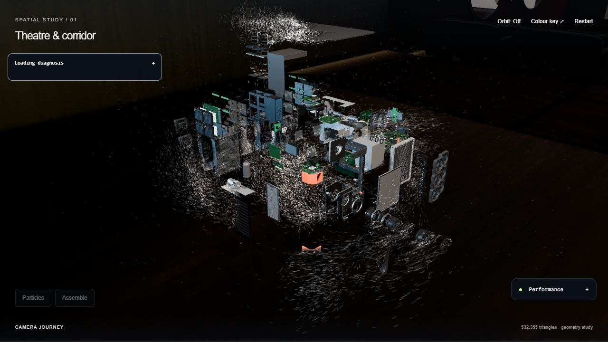
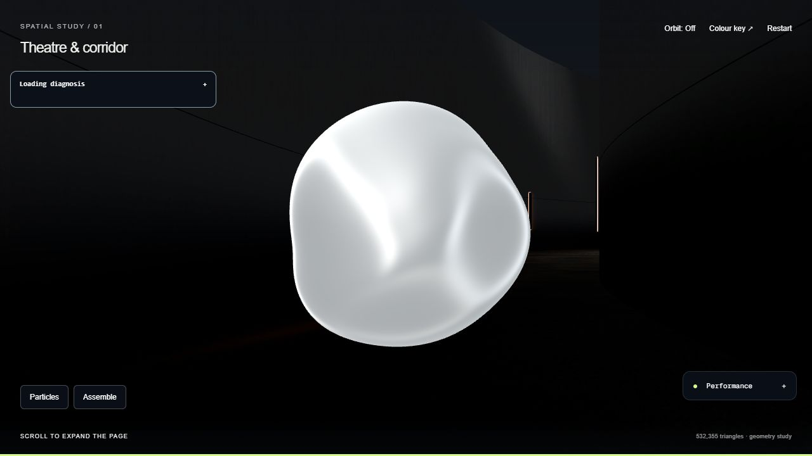

# Liquid motion, page return and projector landing — 26 October 2026

Only the three requested behaviours were changed.

## Whiter moving water

The pearl uses a whiter, cooler base and restrained highlights. Two broad travelling waves replace the stronger metallic crease. It continuously turns and ripples at the initial pearl stop, then follows the existing rectangle/page transition. It stops animating behind the HTML page and honours reduced motion. The mesh, draw count and texture/model downloads are unchanged. Long waits do not cause the next morph to unwind multiple rotations.

## Return at the final section

Reaching the bottom of section three requests the return immediately from the native scroll event. The extra gesture and quiet-period gate were removed. The scene stays mounted and idle behind the opaque HTML sections, retaining its prepared GPU resources so there is no scene reload at the bottom. The full-screen cover still waits for readiness before revealing the shrinking square. This deliberately retains scene GPU memory during the three HTML sections; it does not keep the 3D animation running there.

## Particles form the current parts

The previous particle samples came from `new_si_two`, whose export preparation widened the exploded layout by 1.5× and refitted its grains. The current optimized model uses its original exploded poses. The particle owner table has 489 entries, while the current render model has 514 parts including component meshes. Reusing the old positions and sweep spans separated landing points from surfaces: 53,781 of 65,536 desktop targets were outside their own current part bounds, by up to 0.607 m.

The landing samples were rebuilt directly on the shipped model's frame-96 triangles in the shared particle-root coordinate system. Each component inherits its source particle owner, clock, gradient bounds and sweep. Both surface reveal and particles use those same spans and timings. Original IDs, particle counts, flight shader, model, assembly poses and two-second assembly are preserved. Grains are hidden exactly when formation ends, so no stray field freezes at the exploded stop.

- Desktop: 65,536 grains, `particles-aligned-desktop-v2.bin.gz`, 1,335,913 bytes.
- Laptop: 32,768 grains, `particles-aligned-laptop-v2.bin.gz`, 672,103 bytes.
- Phones retain material reveal and assembly without flying particles, as previously approved.
- All generated targets are within 0.601 mm of their own sampled triangle, including the intended 0.6 mm surface offset.
- Seven component meshes hidden by the source pose are excluded from sampling, so grains never land on invisible components.
- An independent regression test decodes the shipped GLB and checks grains against their own actual posed triangles, including the marked top cover and panels. It also checks component timing inheritance.
- The original particle files are preserved for reference and are no longer selected by the runtime profiles. No GLB, pose buffer, source Blender file or scene texture was changed.

## Validation and reproduction

Production build/TypeScript, targeted runtime lint and all 44 regression tests pass. Source ownership was read from the connected optimized Blender file without changing the scene. Numeric fit evidence and original code/data backups: `D:/CodexOutputs/Three_Fixes_20261026/`.

The 1280 × 720 laptop-profile run reached the third section with a single native scroll and started the return 26 ms later. The existing canvas stayed mounted through HTML, and no second projector/liquid preparation was recorded. There were no console errors or recorded browser pauses above 50 ms during the moving sequence; initial/stationary preparation still had pauses. This is a workstation browser check, not a physical-device performance claim.

The final 390 × 844 mobile-profile run also started returning 26 ms after reaching the third-section bottom, with no extra gesture, errors or moving pauses above 50 ms. Before that scroll, its retained native-page canvas reported **Paused · idle**. The matching raw reports and `verification.json` are saved here. These profile/layout checks do not measure a physical phone's speed.

Run `node scripts/align-projector-particles.mjs` to rebuild landing data; `node --test scripts/particle-alignment.test.mjs` independently verifies it. Local frame inspection is available only on localhost/127.* with `?diagnostics=1&fx-test=desktop&formation-frame=66`. The normal LAN preview ignores the frame hold.

